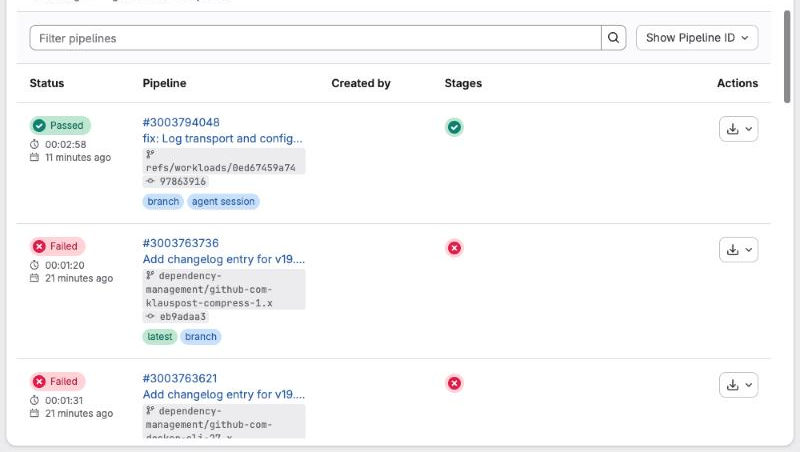
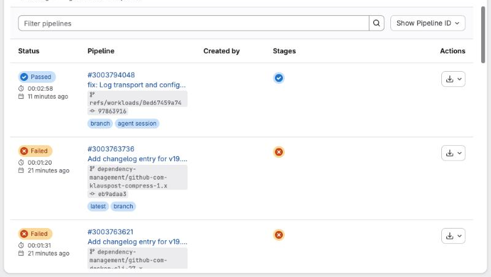

# GitLab Colorblind Mode

A small browser extension that gives GitLab a colorblind-friendly palette, like GitHub's "Protanopia & deuteranopia" theme. Green becomes blue and red becomes orange for pipeline statuses, badges, alerts and buttons.

Code diffs keep GitLab's normal red/green colors.

| Before | After |
| --- | --- |
|  |  |

## Install

### Firefox

1. Open `about:debugging#/runtime/this-firefox`.
2. Click **Load Temporary Add-on…** and pick `manifest.json`.

Temporary add-ons are removed when Firefox restarts. To keep it installed, sign it as an unlisted add-on:

```bash
npx web-ext sign --channel=unlisted --api-key=YOUR_KEY --api-secret=YOUR_SECRET
```

If GitLab doesn't change color, allow the add-on on your GitLab site under `about:addons` → GitLab Colorblind Mode → **Permissions**.

### Chrome, Edge, Brave

1. Open `chrome://extensions`.
2. Turn on **Developer mode**.
3. Click **Load unpacked** and pick this folder.

## Self-hosted GitLab

Add your GitLab address to `content_scripts.matches` in `manifest.json` and reload the extension.

## How it works

- `colorblind.css` points GitLab's green and red palette variables at its own blue and orange ones, so everything built from them follows, in light and dark mode.
- `content.js` reads the original palette when the page loads and restores it inside diffs.
- The toolbar popup turns the mode on and off without reloading the page.
